# CloudDevOpsProject

End-to-end Cloud DevOps microservices deployment on **AWS EKS** using **Terraform**, **Ansible**, **Docker**, **Jenkins** (with a reusable Shared Library), and **ArgoCD** GitOps. Built as part of the Cloud DevOps Accelerator Program (**NTI × iVolve**).

## Architecture Overview

The platform follows an automated Infrastructure-as-Code (IaC), Configuration Management, CI/CD, and GitOps workflow:

1. **Infrastructure Provisioning (Terraform + S3 Backend)**: Provisions networking (VPC, public/private subnets, IGW, NAT Gateway, NACLs), a Jenkins EC2 instance with Security Groups, an EKS cluster (`ivolve-eks`) with worker nodes across private subnets/AZs, and ECR repositories.
2. **Configuration Management (Ansible)**: Uses dynamic EC2 inventory (`aws_ec2.yaml`) and modular roles (`java`, `jenkins`, `docker`, `trivy`, `awscli`) to configure the Jenkins host.
3. **Continuous Integration (Jenkins + Shared Library)**: Each microservice pipeline runs `Build Image`, `Scan Image`, `Push Image`, `Delete Image Locally`, `Update Manifests`, and `Push Manifests` using Groovy steps in `vars/`.
4. **GitOps & Kubernetes Delivery (ArgoCD + EKS)**: ArgoCD (`cloud-devops-project`) continuously reconciles Kubernetes manifests under `k8s/` into the `ivolve` namespace, backed by EBS CSI (`ivolve-storage` StorageClass for MySQL `StatefulSet`) and `ingress-nginx` (`ivolve.local`).

## Application Services

| Service | Stack | Port | Responsibility |
| :--- | :--- | :--- | :--- |
| `frontend` | Node.js 22, Express, EJS | `3000` | Web UI served via `ingress-nginx` (`ivolve.local`) and connected to backend services |
| `auth-service` | Python 3.12, Flask | `5000` | User registration, login, password hashing, and database authentication |
| `roadmap-service` | Java 21, Spring Boot | `8080` | DevOps roadmap API (`/api/roadmap`) |
| `mysql` | MySQL 8.0 | `3306` | Persistent relational database (`StatefulSet` with `1Gi` EBS PVC `data-mysql-0`) |

## Repository Layout

| Path | Description | Status |
| :--- | :--- | :--- |
| `app/` | Source code and Dockerfiles for `frontend`, `auth-service`, and `roadmap-service` | Done |
| `docker-compose.yml` | Local multi-container setup for testing the app stack with MySQL | Done |
| `terraform/` | Remote S3 backend, root config, and modules (`network`, `server`, `eks`, `ecr`) | Done |
| `ansible/` | Dynamic inventory (`aws_ec2.yaml`), `playbook.yml`, and roles (`java`, `jenkins`, `docker`, `trivy`, `awscli`) | Done |
| `k8s/` | Namespace, ConfigMap, StorageClass, MySQL Headless Service & StatefulSet, Deployments/Services, and Ingress | Done |
| `secrets-example/` | Example Kubernetes Secret template (real secrets are never committed) | Done |
| `jenkins/` & `vars/` | Per-service Jenkinsfiles and Shared Library steps (`buildImage`, `scanImage`, `pushImage`, `deleteImage`, `updateManifest`, `pushManifest`) | Done |
| `argocd/` | ArgoCD `Application` manifest (`cloud-devops-project`) for automated GitOps sync | Done |
| `screens/` | Verification and deployment screenshots | Done |

## Setup Instructions

### 1. Local Testing with Docker Compose

```bash
git clone https://github.com/neiorz/CloudDevOpsProject.git
cd CloudDevOpsProject
cp .env.example .env
# Edit .env with your local values
docker compose up -d --build
docker compose ps
```

### 2. Provision AWS Infrastructure (Terraform)

```bash
cd terraform
cp terraform.tfvars.example terraform.tfvars
# Update terraform.tfvars with your environment values
terraform init
terraform validate
terraform plan
terraform apply
```

### 3. Configure Jenkins Server (Ansible)

```bash
cd ../ansible
ansible-galaxy collection install amazon.aws
ansible-playbook -i inventory/aws_ec2.yaml playbook.yml
```

### 4. Deploy & Sync via ArgoCD on EKS

Ensure the ArgoCD `Application` manifest in `argocd/application.yaml` is applied and `ingress-nginx` is installed in the cluster.

```bash
kubectl get pvc,pods -n ivolve -o wide
kubectl get svc -n ingress-nginx
kubectl get ingress -n ivolve
kubectl get applications -n argocd
```

To test `http://ivolve.local` locally when local DNS resolution is delayed, resolve the LoadBalancer IP and map `ivolve.local` in `/etc/hosts` temporarily:

```bash
LB_HOST="<ingress-nginx-controller-external-ip>"
LB_IP=$(dig +short "$LB_HOST" @1.1.1.1 | head -n 1)
echo "$LB_IP ivolve.local" | sudo tee -a /etc/hosts
curl -i --resolve "ivolve.local:80:$LB_IP" "http://ivolve.local/"
```

## Verification & Screenshots

### Terraform & Ansible Provisioning

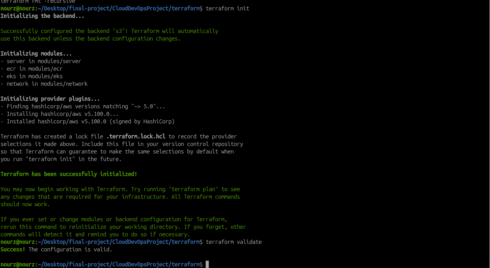
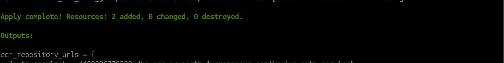
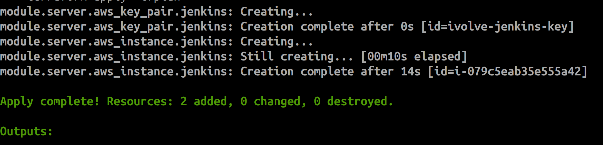
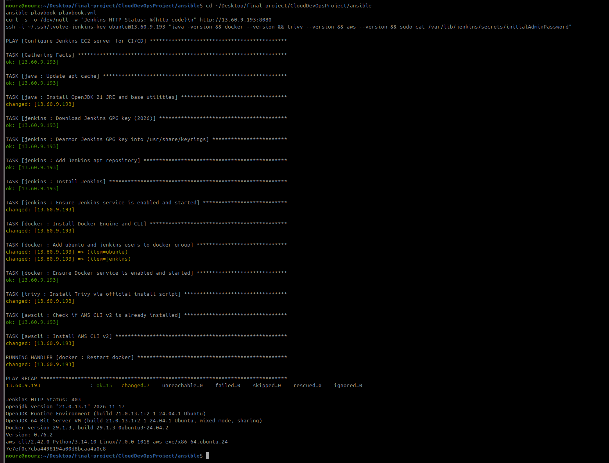
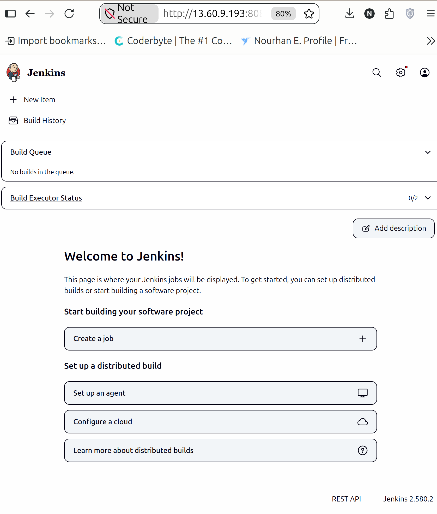
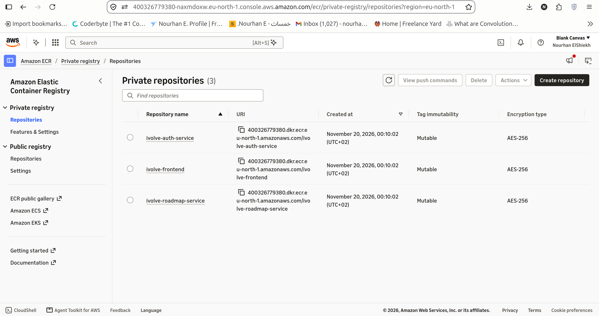

### CI/CD, GitOps & EKS Runtime

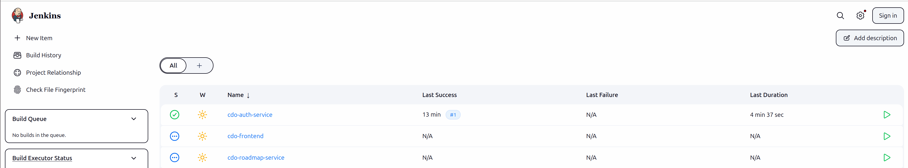
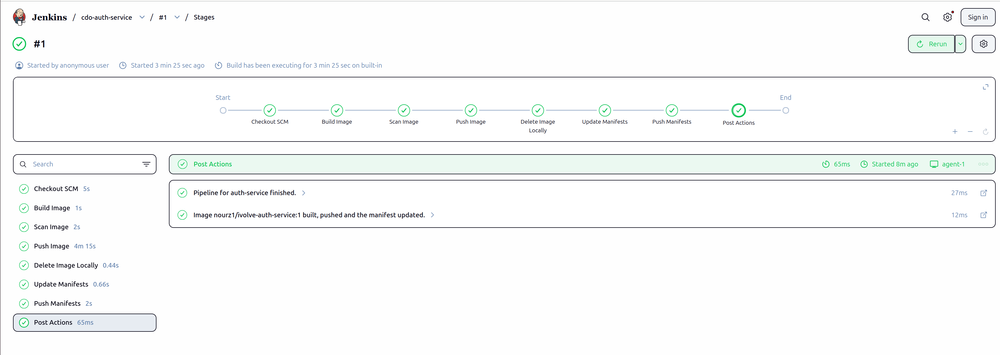
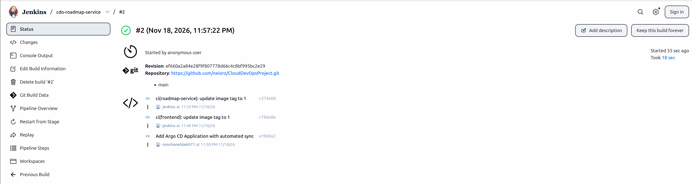
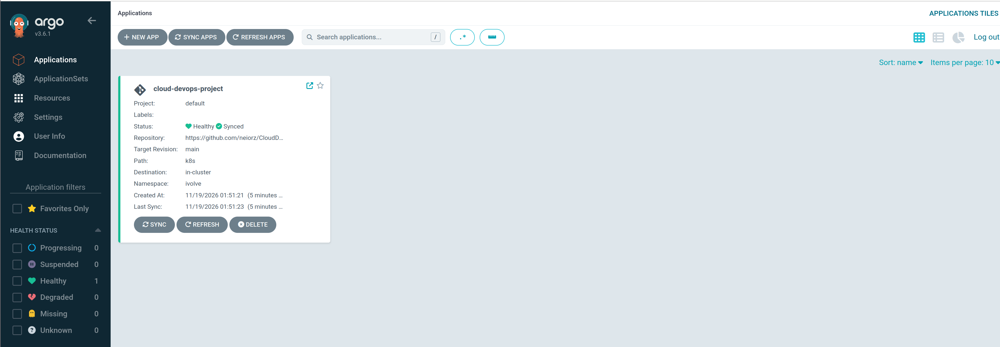
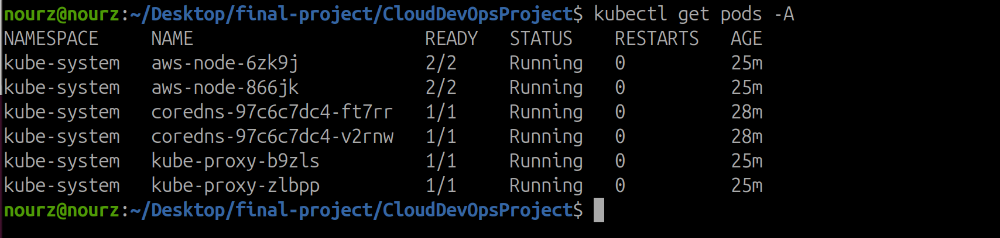
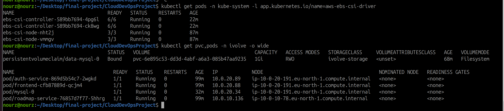
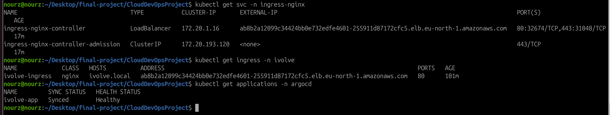

### Application & Database Verification

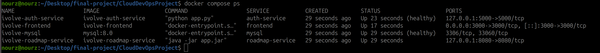
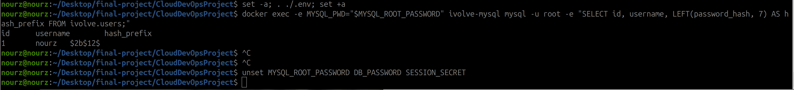
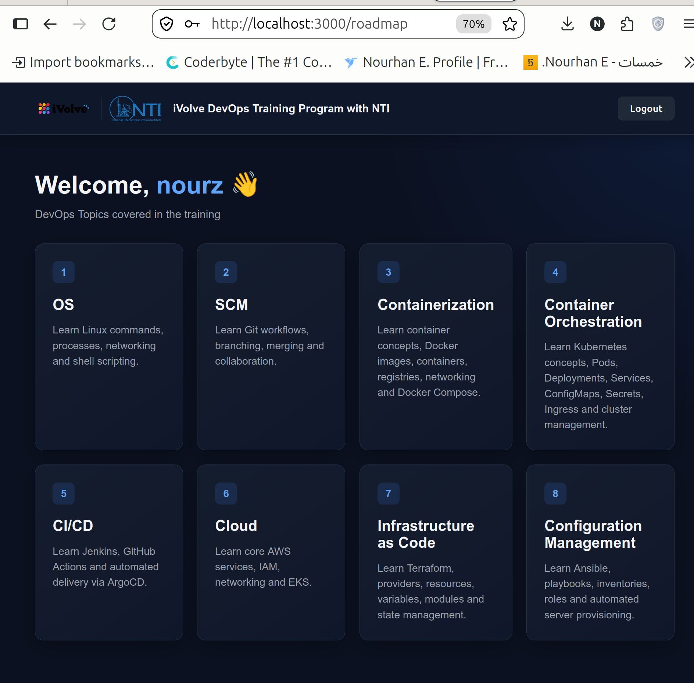
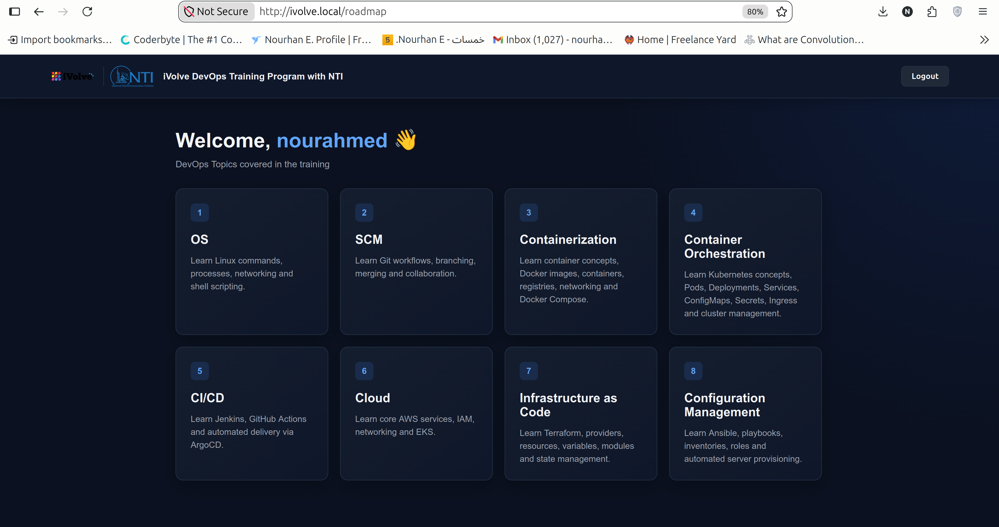

## Operational Notes & Lessons Learned

* **IMDSv2 Hop Limit for EBS CSI**: Worker EC2 instances required `HttpPutResponseHopLimit` set to `2` so pods/controllers using IMDSv2 could retrieve credentials cleanly for EBS volume provisioning.
* **Instance Sizing & Pod Density**: Running on `t3.small` worker nodes requires keeping replica counts lean and monitoring pod limits per node.
* **Secrets Management**: Never commit `.env`, `terraform.tfvars` with sensitive values, or live Kubernetes Secrets; use `.env.example`, `terraform.tfvars.example`, and `secrets-example/`.

## Cleanup

The AWS resources (EKS, NAT Gateway, EC2 and the load balancer) are billed by the hour, so remove them when the project is finished. The order matters:

```bash
# 1. Stop Argo CD first, otherwise it recreates what is deleted (selfHeal is on)
kubectl -n argocd delete application cloud-devops-project

# 2. Delete the load balancer and the volume claims
kubectl delete ingress --all -n ivolve --ignore-not-found
kubectl delete namespace ingress-nginx --ignore-not-found
kubectl delete pvc --all -n ivolve --ignore-not-found

# 3. The StorageClass uses reclaimPolicy Retain, so the EBS volume of the database stays.
#    Delete the leftover volume of the claim data-mysql-0
kubectl delete pv --all --ignore-not-found
aws ec2 describe-volumes --region eu-north-1 \
  --filters "Name=tag:kubernetes.io/created-for/pvc/name,Values=data-mysql-0" \
  --query "Volumes[].VolumeId" --output text
aws ec2 delete-volume --region eu-north-1 --volume-id <volume-id-from-the-command-above>

# 4. Destroy the infrastructure
cd terraform
terraform destroy
```

Finally, check in the AWS console that no EC2 instance, NAT Gateway, load balancer, EKS cluster or volume is left, and remove the local `ivolve.local` line from `/etc/hosts`.
